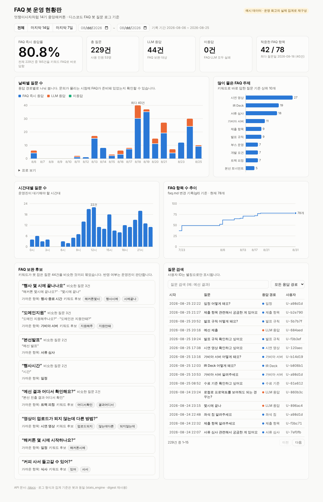

# FAQ 봇 운영 현황판

해커톤 FAQ 봇이 쌓은 질문 로그(`stats.log`, `unanswered.log`)를 집계해,
운영진이 **브라우저에서 한눈에** 볼 수 있게 만든 내부 대시보드입니다.



## 왜 만들었나

14기를 운영하면서 운영진이 로그를 보는 방법은 두 가지였습니다.

- 터미널에서 `python stats_cli.py` — 전체 합계만 나오고, **언제** 몰렸는지는 안 보인다
- 매일 아침 디스코드로 오는 미답변 리포트 — 하루치 텍스트라 **추이**를 볼 수 없다

그래서 회고(`RETROSPECTIVE.md`)의 "피크는 행사 당일이 아니라 마감 1주 전" 같은 결론도
행사가 끝난 뒤 로그를 따로 집계하고 나서야 알 수 있었습니다. 현황판은 그 숫자를 **행사 중에** 보게 하려고 만들었습니다.

| 운영진이 묻는 것 | 현황판에서 보는 곳 |
|---|---|
| 봇이 질문을 얼마나 바로 처리하고 있나? | **FAQ 즉시 응답률** (키워드 적중 / 전체) |
| 문의가 언제 몰리나? 그때 FAQ가 준비돼 있었나? | **날짜별 질문 수** (응답 경로별 누적) |
| 운영진이 몇 시에 대기해야 하나? | **시간대별 질문 수** |
| FAQ에서 뭘 두껍게 써야 하나? | **많이 물은 FAQ 주제** |
| 다음에 FAQ에 뭘 추가해야 하나? | **FAQ 보완 후보** (못 잡은 질문 묶음 + 키워드 후보) |
| FAQ를 언제 얼마나 보강했나? | **FAQ 항목 수 추이** (faq.md git 기록) |
| 특정 질문을 누가 언제 물었나? | **질문 검색** (사용자는 별칭으로만 표시) |

기간 필터(전체 / 마지막 14일 / 마지막 7일 / 직접 지정)는 화면 위 한 줄에 있고,
아래 모든 숫자·차트·표가 같은 기간으로 다시 계산됩니다.

## 구조

```
디스코드 봇 ──(기록)──▶ stats.log / unanswered.log ──(읽기 전용)──▶ FastAPI ──▶ React 현황판
                         faq.md ─────────────────────────────────┘
```

- **봇 코드는 한 줄도 바꾸지 않았습니다.** 현황판은 로그와 `faq.md`를 읽기만 합니다.
- **집계·묶기 기준은 봇과 같은 코드를 씁니다.** `faq_engine.load_faq()`,
  `digest.analyze()`, `digest.read_questions()`를 그대로 import합니다.
  로직을 복사해 두면 봇의 일일 리포트와 현황판 숫자가 조용히 어긋나기 때문입니다.
- 로그 줄 해석 규칙(구 3칸 / 신 4칸 형식 혼재)도 봇의 `collect_stats()`와 같습니다.
  형식이 깨진 줄은 건너뛰되, **몇 줄을 건너뛰었는지 화면 위에 경고로 띄웁니다.**
  (봇에서 깨진 줄이 조용히 버려져 통계가 0으로 나간 일을 두 번 겪었기 때문입니다.)

| 폴더 | 내용 |
|---|---|
| `api/app/` | FastAPI 앱 (`main.py` 엔드포인트, `logs.py` 로그 읽기, `schemas.py` 응답 형식) |
| `api/tests/` | API 회귀 테스트 (pytest) |
| `web/` | React + TypeScript + Vite 화면, Recharts 차트 |
| `scripts/make_sample_logs.py` | 시연용 예시 로그 생성 |
| `scripts/build_faq_history.py` | git 기록 → FAQ 항목 수 추이 JSON |
| `sample-data/` | 예시 로그 (실제 학생 데이터 아님 — 아래 참고) |
| `docker-compose.yml` | 운영용 (실제 로그, 토큰 필수) |
| `docker-compose.demo.yml` | 시연용 (예시 데이터, 공개 가능) |

## 개인정보 원칙

실제 로그에는 **학생 질문 원문과 디스코드 사용자 ID**가 들어 있습니다.

- **사용자 ID는 API 밖으로 나가지 않습니다.** `U-1a2b3c` 같은 별칭(솔트를 섞은 해시)으로만
  내보내고, 테스트(`test_raw_user_id_never_leaves_the_api`)가 이를 지킵니다.
- **운영용 배포는 접근 토큰(`DASHBOARD_TOKEN`)이 필수**이고, 기본 포트는 서버 내부(127.0.0.1)에만 열립니다.
- **로그는 이미지에 굽지 않습니다.** `.dockerignore`가 로그를 막고, 실행 시 읽기 전용으로 마운트합니다.
- **공개 시연은 `sample-data/`의 예시 데이터로 합니다.** 이 데이터는 `RETROSPECTIVE.md`의
  실제 집계(날짜별 건수, 주제별 적중 수, 229건 / 키워드 185건 / LLM 44건 / 미응답 0건 /
  순 사용자 53명)에 맞춰 재구성했습니다. 질문 문장·사용자 ID·시각은 실제가 아니며,
  LLM으로 넘어간 질문 문장은 회고 문서에 이미 공개된 표현을 썼습니다.
  (`test_sample_data_matches_retrospective`가 집계가 회고와 같은지 확인합니다.)

## 로컬에서 실행

저장소 루트에서:

```bash
# 1) API
pip install -r dashboard/api/requirements.txt
DATA_DIR=dashboard/sample-data DASHBOARD_DEMO=1 \
  uvicorn app.main:app --app-dir dashboard/api --reload --port 8000
# → http://localhost:8000/docs  (API 문서)

# 2) 화면 (다른 터미널)
cd dashboard/web
npm install
npm run dev
# → http://localhost:5173  (/api 요청은 8000으로 자동 전달)
```

실제 로그로 보려면 `DATA_DIR`을 봇의 로그 폴더로 바꾸면 됩니다.

## 도커로 실행

```bash
cd dashboard

# 시연용 (예시 데이터)
docker compose -f docker-compose.demo.yml up -d --build
# → http://localhost:8080

# 운영용 (봇 서버에서 실제 로그)
cp .env.example .env        # DASHBOARD_TOKEN, LOG_DIR 채우기
docker compose up -d --build
```

### 봇 서버(오라클 VM)에 띄울 때 — 권장

무료 AMD 인스턴스는 RAM이 1GB라 도커를 올리기엔 빠듯합니다. 그래서 서버에서는 도커 없이,
**봇과 같은 가상환경에 FastAPI만 더 깔고 uvicorn 하나로 화면까지 내보냅니다.**
봇처럼 systemd 서비스로 등록되어 재부팅해도 다시 뜹니다.

```bash
# 서버에 SSH로 접속한 뒤
cd ~/hackathon-faq-bot
git pull
bash dashboard/deploy/setup.sh
```

스크립트가 하는 일:

1. 봇 가상환경에 FastAPI·uvicorn 설치
2. Node 18 이상이 없으면 Node 20 설치 후 화면 빌드 (1GB 서버에서 1~3분)
3. `dashboard/.env.server` 생성 — **접근 토큰과 ID 솔트를 무작위로 만들고**, 로그 폴더는 봇 `.env`의 `DATA_DIR`(없으면 봇 폴더)
4. `faq-dashboard` 서비스 등록·시작 후 `/api/health`가 실제로 응답하고 `stats.log`가 보이는지 확인
5. 접속 방법(SSH 터널 명령과 토큰이 붙은 주소) 출력

현황판은 **서버 안(127.0.0.1:8080)에서만** 열립니다. 방화벽 포트를 열지 않고 SSH 터널로 봅니다.

```bash
# 내 컴퓨터에서 (평소 서버 접속 명령에 -L 옵션만 추가)
ssh -L 8080:127.0.0.1:8080 ubuntu@<서버 IP>
# 그 창을 켜 둔 채로 브라우저에서 → http://localhost:8080/?token=<토큰>
```

코드를 갱신했으면 `git pull && bash dashboard/deploy/setup.sh`를 다시 실행하면 됩니다(여러 번 실행해도 안전).

## API

| 경로 | 내용 |
|---|---|
| `GET /api/health` | 로그 파일 인식 여부, 기록 기간, 건너뛴 줄 수 (토큰 없이 열림, 질문 내용 없음) |
| `GET /api/summary` | 총 질문, 사용 인원, 응답 경로별 건수, FAQ 즉시 응답률, 적중 FAQ 항목 수 |
| `GET /api/daily` | 날짜별 질문 수 (FAQ / LLM / 미응답). 질문 없는 날도 0으로 채움 |
| `GET /api/hourly` | 시간대(0~23시)별 질문 수 |
| `GET /api/topics` | FAQ 주제별 적중 수 |
| `GET /api/questions` | 질문 원문 검색 (`q`, `route`, 페이지) |
| `GET /api/suggestions` | FAQ 보완 후보 — 봇 일일 리포트와 같은 `digest.analyze()` 결과 |
| `GET /api/faq` | FAQ 항목 수, 카테고리별 항목 수, 날짜별 추이 |

모든 집계 API는 `start`, `end`(YYYY-MM-DD, 양 끝 포함)로 기간을 거를 수 있습니다.
자세한 형식은 `/docs`에서 확인하세요.

`/api/suggestions`는 질문끼리 유사도를 전부 비교해서 첫 계산에 수 초가 걸립니다.
로그와 `faq.md`가 바뀌지 않았으면 결과를 재사용하고, 화면도 이 값을 따로 불러와
나머지 지표가 기다리지 않게 했습니다.

## 테스트

```bash
python -m pytest dashboard/api/tests -q
```

고정하고 있는 것:

- 구(3칸)/신(4칸) 로그 형식이 섞여 있어도 모두 집계, 깨진 줄 수는 보고
- 사용자 ID 원본이 어떤 응답에도 나가지 않음
- 날짜 범위 필터 (시작일 > 종료일이면 400)
  - `start`·`end`에 같은 `Query` 객체를 쓰면 FastAPI가 두 값을 묶어 버리는 문제를 실제로 겪어 고정
- 질문 검색은 공백·대소문자를 무시
- 비슷한 미답변 질문이 한 묶음으로 묶임
- 토큰을 설정하면 토큰 없는 요청은 401
- 예시 데이터의 집계가 운영 회고와 일치

## 예시 데이터 다시 만들기

```bash
python dashboard/scripts/make_sample_logs.py      # sample-data/ 갱신
python dashboard/scripts/build_faq_history.py     # FAQ 추이 갱신 (faq.md를 고친 뒤)
```
